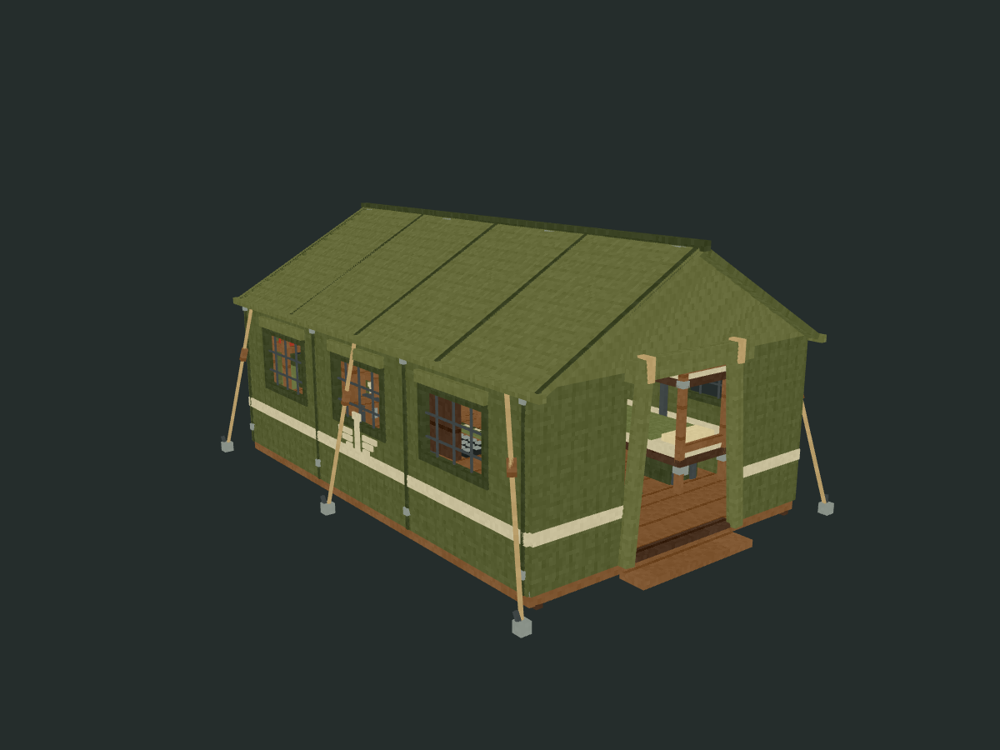
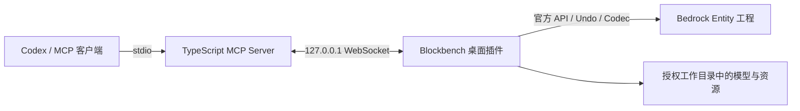

# Blockbench AI MCP

**让支持 MCP 的 AI 客户端直接操作本机 Blockbench，完成 Minecraft 基岩版实体的建模、贴图绑定、骨骼动画、渲染与资源导出。**

> **v0.7.0**，**29 个工具**，通过 Blockbench 官方 API 修改工程，支持批量 Undo/Redo、逐面 UV、建模诊断和可编辑 `.bbmodel` 保存。

[快速开始](#快速开始) · [完整使用指南](docs/usage.md) · [工具示例](#工具一览) · [架构设计](docs/architecture.md) · [MIT 许可证](LICENSE)



*实际建模案例：702 个方块、19 个骨骼的野外指挥帐篷，包含完整内饰。采用作者选定的示例版本，由 MCP 创建、保存、导出和渲染。[查看案例](models/field_tent/README.md)*

## 功能特点

- **批量建模**：创建方块、组织骨骼层级、调整枢轴和旋转；使用起点与终点创建或对齐杆件。
- **贴图与 UV**：导入工作目录内的 PNG 图集，绑定方块并设置 Box UV 或逐面 UV；查询实际面 UV 与像素尺寸，修复薄零件的退化取样。
- **检查与修复**：批量原位修改方块，诊断 UV/零体积问题，检查静态及指定动画时刻的潜在穿模；按 ID 切换工程标签。
- **骨骼动画**：创建动画、批量编辑三通道关键帧，并预览指定时刻。
- **预览与交付**：指定透视或正交相机导出 PNG；保存 `.bbmodel`，导出 Bedrock 模型 JSON、动画 JSON 和 PNG。
- **可靠编辑**：严格参数校验、整批预检、原生 Undo 事务、错误码、超时处理与断线重连。
- **本地通信**：stdio MCP Server 与桌面插件通过仅监听 `127.0.0.1` 的 WebSocket 通信，文件操作限定在授权工作目录。

## 工作方式



服务端使用官方 MCP TypeScript SDK，工具参数由共享 Zod schema 校验。插件调用 Blockbench 的模型、动画、渲染与保存接口，不提供 `eval`、Shell 或任意代码执行工具。AI 客户端与模型服务由使用者自行配置；本项目负责本机 Blockbench 桥接。

## 快速开始

### 1. 环境要求

| 依赖 | 要求 |
| --- | --- |
| Node.js | 推荐 24；支持 `^22.12.0 \|\| ^24.0.0 \|\| >=26.0.0` |
| Blockbench | 5.2.2+ 桌面版，主版本 5；不支持 Web 版 |
| MCP 客户端 | 支持 stdio，例如 Codex |
| 工程格式 | Minecraft Bedrock Entity |

已在 Windows、Node 24.14.0、Blockbench 5.2.2 上验证；其他桌面操作系统尚未完成真实宿主验收。

### 2. 安装与初始化

克隆或下载仓库后，在仓库根目录执行：

```sh
npm ci --include=dev
npm run check
```

构建生成 `dist/server/index.js` 和 `dist/plugin/blockbench_ai_mcp.js`。以当前仓库作为授权工作目录，在 PowerShell 中运行：

```powershell
npm run setup -- --workspace (Get-Location).Path
```

其他 Shell 可将 `--workspace` 替换为仓库的绝对路径。初始化生成 `.blockbench-ai-mcp.json`，包含端口与连接密钥；已有配置不会被覆盖，无需重复初始化。不要提交该文件。

### 3. 配置 MCP 客户端

在 Codex 的 `~/.codex/config.toml` 中加入以下配置，**将所有 `C:/path/to/BlockBenchMCP` 替换为本机仓库的绝对路径**：

```toml
[mcp_servers.blockbench_ai]
command = "node"
args = ["C:/path/to/BlockBenchMCP/dist/server/index.js", "--workspace", "C:/path/to/BlockBenchMCP"]
cwd = "C:/path/to/BlockBenchMCP"
startup_timeout_sec = 15
tool_timeout_sec = 30
```

如果客户端找不到 `node`，将 `command` 改为 Node 可执行文件的绝对路径。其他 MCP 客户端使用相同的命令和参数配置 stdio 服务。完整的工具白名单示例见 [codex-config.toml](examples/codex-config.toml)。

重新启动客户端的 MCP 服务。客户端会启动 Server，无需再单独运行 `npm start`；同一端口不能同时运行多个 Server。

### 4. 加载 Blockbench 插件

1. 在 Blockbench 插件管理中选择从文件加载，打开 `dist/plugin/blockbench_ai_mcp.js`。
2. 在顶部 **Tools / 工具** 菜单中选择 **Blockbench AI MCP: Connect**。
3. 将 **Workspace directory** 填为初始化时的工作目录绝对路径，按需允许该目录的文件访问权限。
4. 出现连接成功提示后，即可通过 MCP 客户端调用工具。

工具已注册但插件尚未连接时，会返回 `NOT_CONNECTED`。升级插件时须同步重启客户端的 MCP 服务端；v0.7.0 使用桥接协议 v7，旧版本不会混用。只重载插件而没有重启旧服务端，会无法连接。使用工具白名单时，也要加入新增的 7 个工具。

Connect 窗口的 Status 随连接实时更新。如果旧构建的窗口停在 `Connecting`，但 MCP 查询成功，可能是旧状态显示未刷新；关闭窗口后重新打开可查看最新状态，重载修正版插件可启用实时显示。

### 5. 开始建模

可以向客户端提出类似请求：

> 新建一个名为 robot_demo 的基岩版实体工程，创建躯干与头部骨骼，批量创建方块并查询状态，最后保存为 models/robot_demo.bbmodel。所有文件都放在授权工作目录内。

最小闭环是 `create_project` → `create_cubes` → `get_project_state` → `save_project`。修改时使用工具返回的真实工程与元素 ID，保存目标的父目录须已存在。

## 工具一览

| 类别 | 工具 | 示例与说明 |
| --- | --- | --- |
| 工程 | `create_project`、`get_project_state`、`save_project`、`list_projects`、`select_project` | [基础工具](docs/usage.md#四个基础工具)、[标签切换](docs/phase-seven-usage.md) |
| 方块与杆件 | `create_cubes`、`update_cubes`、`create_beams`、`align_beams` | [两点杆件示例](examples/phase-six-tool-calls.json)、[原位修改](docs/phase-seven-usage.md) |
| 骨骼 | `create_bones`、`update_bones`、`reparent_cubes` | [骨骼与贴图示例](examples/phase-two-tool-calls.json) |
| 贴图与 UV | `import_texture`、`assign_texture`、`set_cube_uv`、`get_cube_uv`、`set_face_uv` | [骨骼与贴图示例](examples/phase-two-tool-calls.json)、[薄件 UV 修复](docs/phase-seven-usage.md) |
| 诊断 | `validate_project`、`check_collisions` | [质量检查与限制](docs/phase-seven-usage.md) |
| 动画 | `create_animation`、`update_animation`、`set_keyframes`、`delete_keyframes`、`get_animation_state`、`preview_animation` | [动画示例](examples/phase-three-tool-calls.json) |
| 导出 | `export_bedrock_model`、`export_bedrock_animations`、`export_texture_png` | [导出示例](examples/phase-four-tool-calls.json) |
| 渲染 | `render_project` | [相机与动画时刻示例](examples/phase-five-tool-calls.json) |

方块、骨骼、杆件与关键帧的批量修改每次最多 256 项，每批使用一个 Undo 步骤。详细参数、限制和错误恢复见[使用指南](docs/usage.md)与[协议说明](docs/protocol.md)。

## 使用边界

- 仅支持当前插件管理会话创建的活动工程。手动打开或插件重载前的工程可以查询，但不能直接接管修改；普通网络断线自动重连保留管理会话。
- 贴图使用一张共享 PNG 图集，支持 Box UV 与逐面 UV；暂不支持贴图绘制、图集替换或多材质。
- 诊断返回可核查的警告，不自动美化或移动零件。穿模检查仅覆盖选中的方块、指定时刻，正常连接处也可能重叠；不能证明整段动画无碰撞。
- 动画支持数值骨骼关键帧与 linear/step 插值；暂不支持 Molang、IK、动画控制器和效果轨道。
- 导出提供资源文件，尚不自动组装完整的 Minecraft 资源包。
- 文件路径必须位于授权工作目录内；覆盖需要显式设置 `overwrite:true`。超时或断线可能发生在修改已完成之后，应先查询状态再决定是否重试。
- 本项目不是 Blockbench、Mojang、Microsoft 或 OpenAI 的官方产品。

## 开发与验证

```sh
npm run typecheck        # 严格 TypeScript 检查
npm run test:unit        # 单元测试
npm run test:integration # WebSocket / stdio / 插件构建集成测试
npm run build           # 构建服务端与插件
npm run check           # 以上类型检查、全部测试与构建
```

v0.7.0 通过 **207 项自动化测试**，新增能力的真实 Blockbench 验收见[第七阶段验证](docs/phase-seven-verification.md)。此前各阶段已验证建模、骨骼、贴图、动画、导出、渲染与端点对齐；自动化替身测试不等同于真实宿主测试：

- [骨骼与贴图验证](docs/phase-two-verification.md) · [动画验证](docs/phase-three-verification.md)
- [资源导出验证](docs/phase-four-verification.md) · [渲染验证](docs/phase-five-verification.md)
- [杆件端点与批量 Undo/Redo 验证](docs/phase-six-verification.md)
- [工程标签、逐面 UV 与穿模诊断](docs/phase-seven-usage.md) · [设计依据](docs/phase-seven-architecture.md)

独立桌面冒烟测试见[手动验收说明](docs/manual-smoke-test.md)。运行前停止占用同端口的 MCP 服务；测试会在宿主中新建工程并写入测试文件。

```text
src/shared/         协议、参数 schema、工作目录策略
src/server/         stdio MCP Server 与 WebSocket 桥接
src/plugin/         桌面插件及官方 API 适配
tests/              单元与通信集成测试
scripts/            构建、初始化和真实宿主验证
docs/               使用指南、架构与验证记录
examples/           客户端配置和工具调用示例
models/field_tent/  实际建模案例与导出资源
```

欢迎通过 Issue 反馈问题或通过 Pull Request 提交改进。提交前运行适用检查，说明真实宿主测试是否执行；Git 提交保留 `feat:`、`fix:`、`chore:` 等英文类型前缀，冒号后的说明及正文使用中文，工具名及技术标识可保留英文。不要提交连接密钥、依赖、构建产物、临时日志或测试生成的工程。

## 许可证

采用 [MIT License](LICENSE)，Copyright © 2026 Terrxx。第三方依赖各自遵循其许可证。
