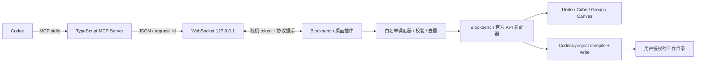

# Blockbench AI MCP — 架构与阶段计划

调研日期：2026-11-13。用户已选择 **Minecraft Bedrock Entity**，工程格式 ID 为 `bedrock`。

## 0. 范围与实施顺序

最终方向包含模型、贴图、骨骼、动画、渲染与资源导出。第一阶段交付 `create_project`、`get_project_state`、`create_cubes`、`save_project`，已完成真实桌面及 Codex 原生验收。第二阶段已按用户选择限定为 Bedrock 骨骼、工作目录 PNG 导入、方块绑定和 Box UV，设计与实施门槛见[第二阶段架构](phase-two-architecture.md)。第三阶段新增骨骼数值动画，见[第三阶段架构](phase-three-architecture.md)与[真实验证](phase-three-verification.md)。第四阶段导出模型、动画 JSON 和 PNG，见[资源导出架构](phase-four-architecture.md)。第五阶段增加指定相机与动画时刻的 PNG 渲染，见[渲染架构](phase-five-architecture.md)。下文保留第一阶段的实现依据。

按以下门槛推进，每一阶段先验证再继续：

1. 官方 API 调研与本文档。
2. 严格类型的共享协议、参数校验、工作目录策略；单元测试通过。
3. 回环 WebSocket 桥接、身份验证、超时、重连、请求去重；通信集成测试通过。
4. Blockbench 官方 API 适配、桌面插件与四个 stdio MCP 工具；构建、适配器测试、真实 stdio 通信测试通过。
5. README、Codex 配置、可复现的桌面手动冒烟步骤与验证记录。自动化替身测试不等同于桌面实测。

## 1. 官方资料与决定

| 来源 | 核实结果与实现决定 |
| --- | --- |
| [MCP TypeScript SDK 官方仓库](https://github.com/modelcontextprotocol/typescript-sdk)；[server 包](https://github.com/modelcontextprotocol/typescript-sdk/tree/main/packages/server)；npm 官方 registry 查询 | v2 是当前稳定线，分为 `@modelcontextprotocol/server` 和 `@modelcontextprotocol/client`；2026-11-13 查询 server 为 **2.4.0**。使用精确版本与 lockfile，不沿用 v1 示例。 |
| [官方 stdio 文档](https://ts.sdk.modelcontextprotocol.io/v2/serving/stdio) | MCP 使用 stdin/stdout，诊断日志只写 stderr。 |
| [Blockbench 官方插件文档](https://www.blockbench.net/wiki/docs/plugin/)；[v5.2.2](https://github.com/JannisX11/blockbench/releases/tag/v5.2.2) | 插件 ID 与 JS 文件名相同；桌面专用；正确清理 Action、连接、重连定时器。当前官方类型包为 `blockbench-types@5.2.1`。兼容基线限定为 5.2.2。 |
| [project.ts](https://github.com/JannisX11/blockbench/blob/v5.2.2/js/io/project.ts)；[bedrock.js](https://github.com/JannisX11/blockbench/blob/v5.2.2/js/formats/bedrock/bedrock.js) | `newProject(Formats.bedrock)` 建立新标签，不关闭其他工程；设置名称、模型标识和贴图尺寸。新建工程属于生命周期，不伪造可跨工程撤销的 Undo。 |
| [官方 Undo 文档](https://www.blockbench.net/wiki/docs/undo/)；[undo.js](https://github.com/JannisX11/blockbench/blob/v5.2.2/js/undo.js) | 批量新增使用同一个 `Undo.initEdit` / `Undo.finishEdit`；创建前记录空元素列表、groups 和 outliner，创建后记录新元素及 groups。5.2 的 outliner 快照只负责层级，必须显式记录 groups 才能撤销/重做 root 的创建。失败调用 `Undo.cancelEdit(true)`，其 aspects 中更新当前元素与 groups 列表，保留 before 快照供回滚。随后刷新 Canvas。 |
| [math_util.js](https://github.com/JannisX11/blockbench/blob/v5.2.2/js/util/math_util.js#L2) | 原生 guid / isUUID 只约束 8-4-4-4-12 十六进制格式，不保证 RFC 版本/变体位。工程、方块、骨骼 ID 使用原生格式校验，桥接 request_id 仍使用 RFC UUID。真实桌面测试确认了这项差异。 |
| [bbmodel.js](https://github.com/JannisX11/blockbench/blob/v5.2.2/js/formats/bbmodel.js)；[codec.ts](https://github.com/JannisX11/blockbench/blob/v5.2.2/js/io/codec.ts)；[file_system.ts](https://github.com/JannisX11/blockbench/blob/v5.2.2/js/file_system.ts) | 使用 `Codecs.project.compile(...)` 与 `Codecs.project.write(content, path)`；不手写 bbmodel。先更新 save_path 再编译，保证相对资源路径正确。该版本文本写入同步并抛出 I/O 异常；`save_project` 事件发生在编译期间，不能当作落盘成功通知。失败恢复工程保存元数据。 |
| [OpenAI 官方 MCP 配置](https://developers.openai.com/codex/mcp) | 使用 `[mcp_servers.blockbench_ai]` 配置 `command`、`args`、`cwd` 和超时；提供示例，任务不会自行更改用户全局配置。 |

调研源文件仅缓存在忽略的 `.research/`，不作为项目代码发布。

## 2. 模块及数据流

目录职责：`src/shared/` 定义 Zod schema、错误和路径策略；`src/server/` 注册 MCP 工具及桥接；`src/plugin/` 管理插件生命周期并适配宿主；`scripts/` 构建、初始化和冒烟客户端；`tests/` 单元与集成；`docs/` 架构、协议和验收。

## 3. 授权与文件边界

- 用户用 `--workspace` 显式指定已有工作目录；初始化只在这个目录创建 `.blockbench-ai-mcp.json`，包含随机密钥、端口和目录，不提交版本库、不写入日志。
- 插件连接时由用户在 Blockbench 对话框输入同一个工作目录。服务端用 realpath 规范化，插件使用与配置完全相符的绝对目录；根目录不能由工具调用改变。
- MCP 进程监听 **127.0.0.1**，不开放可配置 host；插件使用 Electron 内置 WebSocket，只连接该 IPv4 地址。握手首帧提交随机 token（不放 URL）。只接受无 Origin、`file://`、`null`，拒绝网页 HTTP(S) Origin、非法 Host、错误 token、第二个插件及超大消息。默认端口 30031，可在初始化时指定。
- 工具仅接受相对 `.bbmodel` 路径；拒绝绝对路径、`..`、Windows ADS/设备名、符号链接/junction、硬链接目标及目录越界。父目录须预先存在；默认不覆盖文件，覆盖需 `overwrite: true`。
- 文件系统代码不绕过目录策略。依赖、构建、测试临时文件与 npm 缓存均位于项目内。无任意代码执行、任意命令、通用文件读写、URL 导入或动态方法调用工具。
- 修改与保存要求工程 UUID 与当前活动工程相符；只接管本插件会话创建的工程，防止误改用户已有标签。保存前检查磁盘资源引用，禁止工作目录外的资源读取。
- 路径检查不能消除其他本机进程在检查后替换目录的竞态；工作目录及密钥文件必须由可信本机用户控制。Blockbench 自身的偏好设置/最近工程管理属于宿主行为，插件不直接写其应用数据目录。

### Blockbench 5.2 原生权限适配

[官方 native_apis.ts](https://github.com/JannisX11/blockbench/blob/v5.2.2/js/native_apis.ts) 与 [scoped_fs.ts](https://github.com/JannisX11/blockbench/blob/v5.2.2/js/util/scoped_fs.ts) 表明：插件不能直接加载任意 Node 模块，且 scoped fs 不提供 `lstatSync` / `realpathSync`。因此插件不打包 Node 版 ws、不申请网络或 process 模块权限；只在用户输入目录后调用 `requireNativeModule('fs', {scope})`。

两端共享目录策略。使用逐级 `readdirSync(..., {withFileTypes:true})` 在跟随路径前拒绝符号链接/junction，随后检查普通文件与硬链接数；服务端额外执行 realpath 检查。插件的 scoped fs 由依赖注入提供，构建产物在模块限制仿真中接受测试。宿主自带 scoped fs 的字符串前缀检查不足以独立提供目录隔离，因此不能省略项目自身策略。

## 4. 协议与可靠性

- 内部桥接采用版本化 JSON（不是第二套 MCP）：请求包括 `version`、`type`、`request_id`、`command`、`params`、`deadline_ms`；响应保留同一个 request_id，成功返回结构化结果，失败返回稳定错误码与消息。
- 两端使用相同 schema，严格拒绝未知字段、非有限坐标、空批次、超限批次、过长字符串。四个命令是固定白名单。
- 批次最多 256 个 Cube；调度队列和去重缓存有上限；读取状态分页，避免大型工程撑爆消息。
- 插件按顺序执行，执行前检查绝对截止时间；一次批量添加对应一个 Undo 步骤。默认请求超时 15 秒。
- 未连接立即返回错误；断开时清理 pending。插件指数退避重连；卸载停止重连。通信恢复后可以发新请求。
- 超时/断线不能证明已发出的修改未执行，返回 `outcome_unknown`；不自动重试写入。先读取状态确认，再决定是否重新操作。有限缓存只防止近期相同 request_id 的重复执行，不声称跨重启 exactly-once。
- 心跳检测失联。MCP 取消请求会结束等待；已发出的宿主操作不能强行中断。错误与结构化日志包含 request_id，不包含 token 或整个参数/模型内容。

## 5. 四个工具

| 工具 | 语义 |
| --- | --- |
| `create_project` | 在新标签创建 Bedrock Entity；返回工程 UUID、格式和尺寸。 |
| `get_project_state` | 返回当前工程摘要和分页 Cube 信息，不访问模型磁盘文件。 |
| `create_cubes` | 要求 project_id；预先验证完整批次；使用官方 Cube API、一个 Undo 事务；为 Bedrock 方块提供默认 root 骨骼容器（不开放骨骼编辑工具）。 |
| `save_project` | 要求 project_id、相对路径和可选覆盖标志；用官方工程 codec 保存 `.bbmodel`；不是 Bedrock 资源包导出。 |

未来每个功能模块继续采用专用 schema、白名单 handler、官方 API adapter 与对应测试；本轮不放置虚假成功的占位工具。

## 6. 验证策略

- 协议/路径单测：参数边界、越界、符号链接、覆盖、无效协议版本与错误映射。
- 通信集成：真实回环 WebSocket，鉴权、握手、超时、断开、错误回复、乱序匹配、重连、重复 request_id、队列过期。
- 适配器：可控宿主替身验证官方 API 调用顺序、Undo 成功/回滚、工程切换保护、官方 codec 保存与失败恢复。
- 真实 MCP stdio 子进程：官方 v2 client 初始化、列举四个工具、调用、关闭，并连接真实 WS 上的插件替身。
- 桌面手动：加载实际 bundle，创建 Bedrock 工程、批量方块、Undo/Redo、保存后重新打开、路径拒绝、断线恢复；记录是否真正执行。
