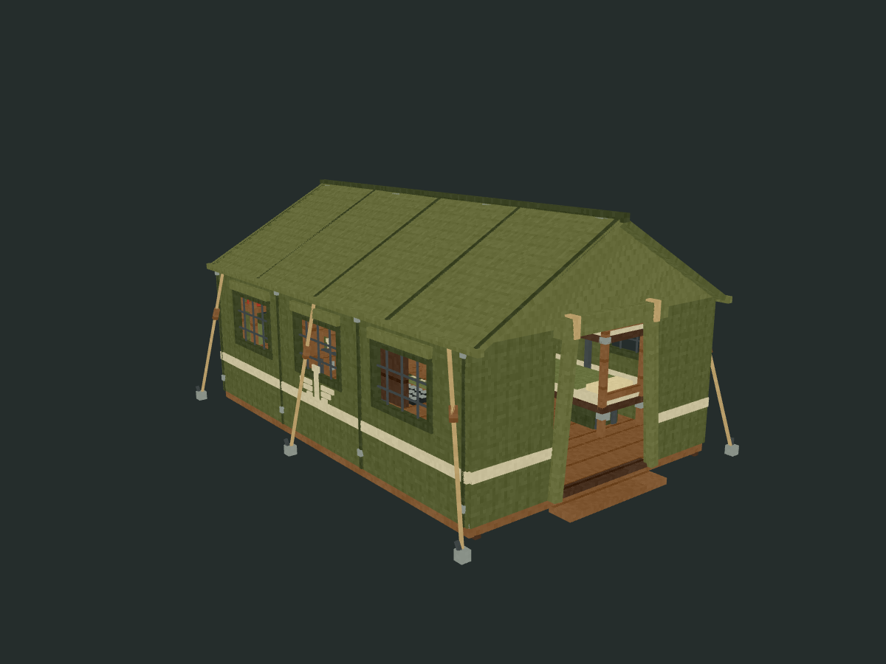

# 野外指挥帐篷示例

仓库只保留最新的杆件对齐版 `aligned/`：**1218 个方块、21 个骨骼、一张 2048 × 2048 PNG 图集**。包含倾斜侧墙、帆布细节、门口支架、工作台、双层床和储物架。

## 仓库资源

- [基岩版模型 JSON](aligned/ranger_field_tent_aligned.geo.json)
- [PNG 图集](aligned/field_tent_atlas.png)
- [剖视展示动画 JSON](aligned/ranger_field_tent_aligned.animation.json)

可在 Blockbench 打开模型 JSON，并导入对应图集继续编辑。动画 `animation.field_tent.cutaway` 在 0 秒显示完整外壳，1 秒缩小外壳以展示内饰，不是布料模拟。模型和动画 JSON、PNG 尚未组装成包含 manifest、client_entity 等文件的完整游戏资源包。

可编辑 `.bbmodel`、本地预览和原始会话不纳入 Git；克隆仓库获得的是上面的三份资源。旧版模型、依赖旧数据的制作脚本及原始实测记录已从当前工作区移除。

## 验证

通过 MCP 的官方 API 创建、保存、导出及渲染；79 根杆件使用 `align_beams` 以端面中心对齐，原生矩阵最大误差约 1.42e-14。一次批量 Undo/Redo 已在真实宿主验证；本阶段未执行关闭重开或游戏内测试。

精简统计和当前资源哈希见 [alignment-verification.json](alignment-verification.json)，方法与边界见[第六阶段验证](../../docs/phase-six-verification.md)。API 使用示例见[两点杆件工具](../../examples/phase-six-tool-calls.json)。
